<h3 align="center">👋 Hey there, I'm Smit</h3>

  

- ▸ Turning **coffee into commits**, bugs into lessons, and wild ideas into production-ready obsessions.
- ▸ Into **GenAI**, **Computer Vision**, or **Full-Stack**? So am I. Let's build something that makes people ask, *"Wait, AI can do that?"*
 

  

  

 

▸ Turning coffee into commits, bugs into lessons, and wild ideas into production-ready obsessions.

▸ Into GenAI, Computer Vision, or Full-Stack? So am I. Let's build something that makes people ask, *"Wait, AI can do that?"*

 

 
 

  
   
  

  

  
  

  
  

  

  

