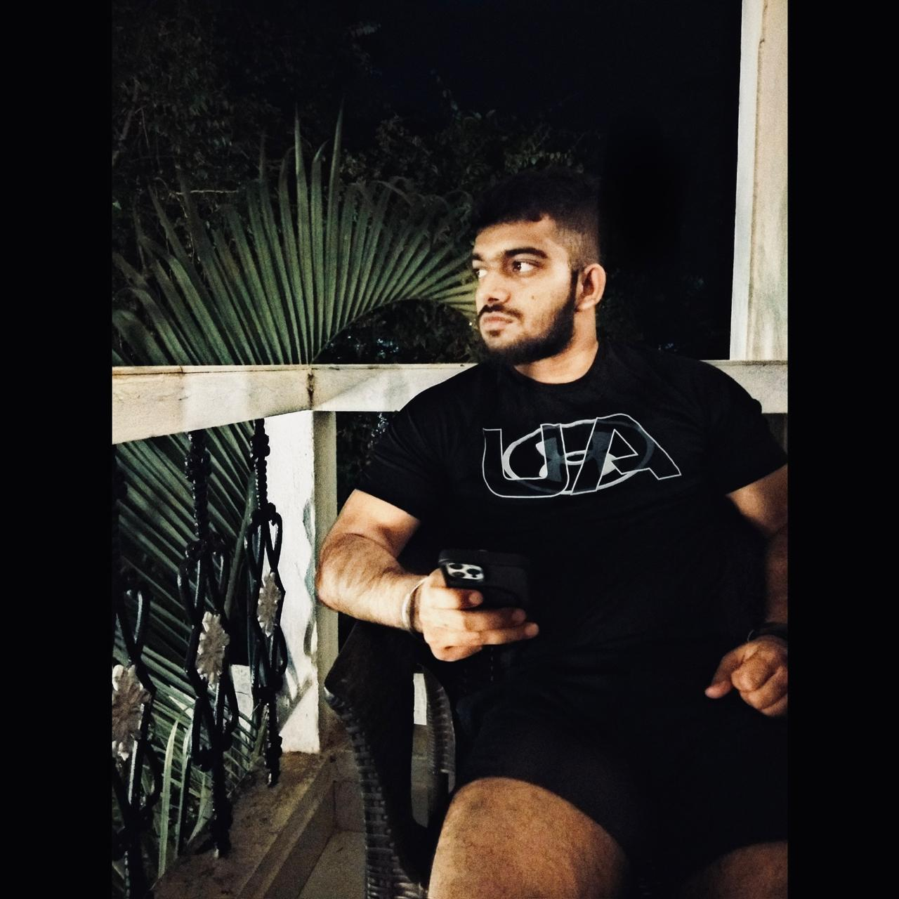

  

  

▸ Turning coffee into commits, bugs into lessons, and wild ideas into production-ready obsessions.
  
▸ Into GenAI, Computer Vision, or Full-Stack? So am I. Let's build something that makes people ask, <i>"Wait, AI can do that?"</i>

  
  
  
  

  
   
  

  
  

  

<picture>
  <source media="(prefers-color-scheme: dark)" srcset="https://raw.githubusercontent.com/smithp17/smithp17/output/snake-dark.svg"/>
  
</picture>

